  

  

  
  

## [ buku ]

**Belajar YouTube dari Nol** — buku digital gratis untuk pemula yang 0 pengetahuan
tentang YouTube tapi mau menghasilkan uang di YouTube. Dari bikin channel sampai
monetisasi, dari pengalaman nyata — bukan teori.

- [Baca bukunya](https://github.com/ilyasahmadalmaki/ilyasahmadalmaki/blob/main/buku-youtube/README.md)

## [ stack ]

  
  
  
  
  
  
  

  

## [ links ]

- Blog: [blackhat-dotcom.blogspot.com](https://blackhat-dotcom.blogspot.com)

  

